 

 

<table>
<tr>
<td align="center" width="140"><b>Languages</b></td>
<td></td>
</tr>
<tr>
<td align="center"><b>Frontend</b></td>
<td></td>
</tr>
<tr>
<td align="center"><b>Backend</b></td>
<td></td>
</tr>
<tr>
<td align="center"><b>Databases</b></td>
<td></td>
</tr>
<tr>
<td align="center"><b>Cloud &amp; DevOps</b></td>
<td></td>
</tr>
<tr>
<td align="center"><b>Tools</b></td>
<td></td>
</tr>
</table>

 

> 🩸 **Latest — [Bloodline](https://github.com/shubhamjh15/blood-donor-network):** a real-time, location-based blood donor network. Next.js 15, MongoDB geo-queries, React Three Fiber, live maps & notifications.

 

<picture>
  <source media="(prefers-color-scheme: dark)" srcset="https://raw.githubusercontent.com/shubhamjh15/shubhamjh15/output/github-snake-dark.svg" />
  <source media="(prefers-color-scheme: light)" srcset="https://raw.githubusercontent.com/shubhamjh15/shubhamjh15/output/github-snake.svg" />
  
</picture>

 

**Got an idea, a SaaS, or something wild to build? Let's talk.**

